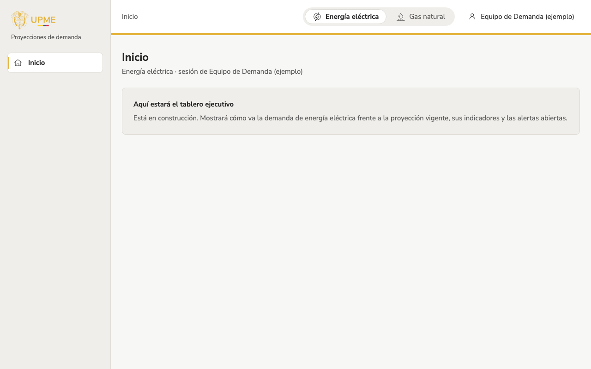

## Qué cambió
La app interna ya tiene su estructura, igual a la del mockup del tablero ejecutivo:
- menú lateral con el logo y las secciones;
- encabezado con el producto activo (energía eléctrica o gas natural) y el nombre del usuario;
- un menú del usuario con sus roles, un enlace al portal público y el botón para cerrar sesión.

Desde el portal público se llega con **Ingresar**, a la derecha del menú superior. Si no hay sesión, se pide ingresar y luego se vuelve a la página que se había pedido. El menú solo muestra las vistas que ya existen y que el rol del usuario puede usar; hoy, «Inicio». El tablero ejecutivo ocupará ese inicio en T-09.

## Por qué
Es la base de todas las vistas internas (T-09 a T-14): menú, producto activo y sesión en un solo lugar.

## Cómo se ve

Captura de esta versión, guardada con el diario: el inicio provisional se reemplazó por el tablero ejecutivo (T-09).

## Notas técnicas
- `AppLayout` (ruta `/app` con hijos y `<Outlet />`), `navigation.ts` (menú de `diseno-app.md` con `built` y `role`), `AppPage` (LAY-05).
- Componentes nuevos: `SideNav`, `AppShell` y `UserMenu`, en la galería; `PublicHeader` acepta una acción a la derecha («Ingresar»).
- Ingreso con regreso a la página pedida: `?siguiente=` para usuario local y `sessionStorage` para Google, porque su retorno del backend siempre es `/app` (`auth/returnTo.ts`, solo destinos `/app…`). Sin cambios en el backend.
- `RequireRole` usa `Skeleton` y `ErrorState`; `LoginPage` tiene «Volver al portal público». La página de ingreso sigue sin mockup (X-06).
- Pruebas: 122 unitarias y un recorrido de Playwright (`e2e/app-shell.spec.ts`) con la sesión simulada. Las capturas de la app también usan una sesión simulada: no se usan credenciales reales.
- Guía técnica: sección «Usuario administrador local» en `docs/tecnica/index.md` y `DEV_ADMIN_PASSWORD` en `.env.example` (sin valor). El comando de creación lee la contraseña del entorno del contenedor `api`, así no queda en el historial de la terminal.
- En teléfono la app no está optimizada (LAY-08 lo permite: optimizada a 1280 px y usable en tablet).
