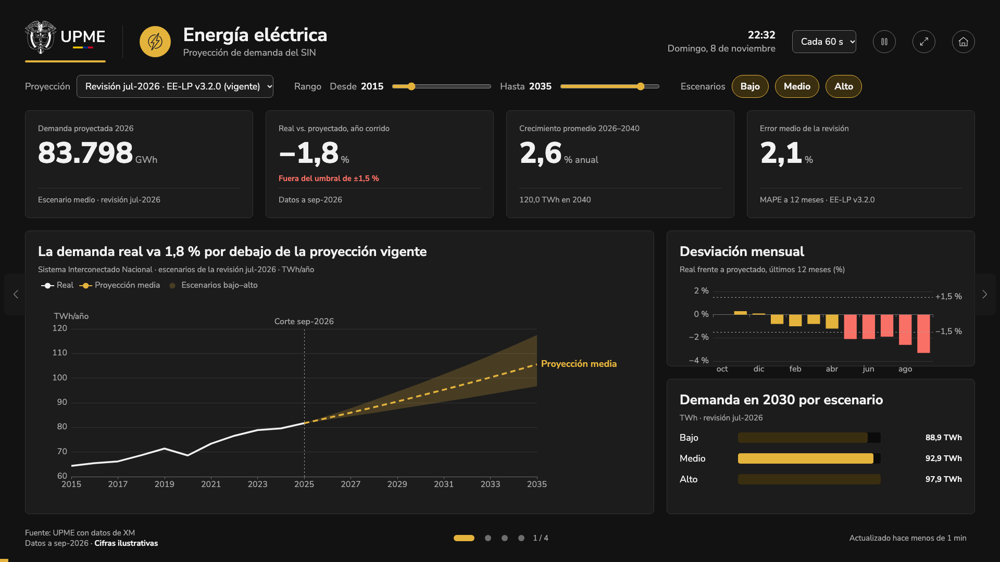

## Qué cambió
Existe el **modo pantalla** (`/pantalla`), pensado para los televisores de la UPME. Muestra cuatro tableros que se turnan solos:

- **Energía eléctrica y gas natural:** la proyección vigente frente al dato real, cuatro cifras clave, la desviación de los últimos 12 meses y la demanda de 2030 por escenario.
- **Comparar proyecciones:** cómo cambiaron las revisiones publicadas y qué tan acertada fue cada una.
- **El sistema hoy:** la demanda diaria reciente de energía y gas.

Los controles son íconos (detener o reanudar, pantalla completa y volver al inicio), y la barra de progreso sigue visible aunque la rotación esté en pausa.

Se puede tocar, arrastrar o pausar, y siempre hay cómo salir: «Volver al inicio» lleva al portal. Al tocar, la rotación espera 30 segundos; si nadie lo usa en 5 minutos, los filtros vuelven a su valor inicial. Si se cae internet, sigue mostrando los últimos datos y lo avisa.

Desde el inicio del portal se llega con un enlace discreto junto al gráfico («Ver en modo pantalla →», solo en computador) y desde el pie de página.

Todas las cifras son ilustrativas.

## Por qué
El modo pantalla es, con el portal, la cara visible del proyecto (etapa 1.1). Permite mostrar las proyecciones oficiales en espacios de la entidad sin que nadie las opere.

## Cómo se ve

## Notas técnicas
- Vista `frontend/src/zones/pantalla/` (`KioskPage`, `KioskProductBoard`, cálculos en `kioskData.ts` con pruebas). Ruta `/pantalla` con `?tableros=` e `?intervalo=` (TV-08).
- `KioskShell`: escenario de 1920 × 1080 escalado, tema oscuro (`data-theme="dark"`, `data-zone="pantalla"`), rotación, barra de progreso, flechas, puntos, arrastre, pausa, reloj e intervalo. Lógica pura en `rotation.ts`, probada con tiempos simulados.
- Componentes nuevos del inventario: `KioskShell`, `VersionSelect`, `RangeSlider` y `Chip`, en la galería (convención del proyecto).
- Datos: nuevo `useRevisionPerformance` (desviación mensual, año corrido, umbral y MAPE), ilustrativo. Se refresca cada 15 min; si falla, React Query conserva los últimos datos (TV-07).
- Gráficos: `projectionChart` acepta escenarios visibles y rango de años; `kioskCharts.ts` con la desviación mensual (barras con signo).
- Salidas: «Volver al inicio» en el encabezado del modo pantalla (sale también de la pantalla completa) y botones de pantalla completa que cambian a «Salir de pantalla completa» (`lib/useFullscreen.ts`), también en `ChartCard`.
- Íconos (en `frontend/src/iconos-locales/`, con su origen, hasta pasarlos al estándar, X-17): `fullScreen`, `chevron-lef` y `chevron-right` de la Librería de Iconos UPME; `pause` y `play` creados en el proyecto con el estilo de la librería (36 × 36, trazo de 1,5 px, `currentColor`), porque la librería no los tiene. Es una excepción a UPME-ICO-01 aprobada por el líder (#15).
- Rotación: el tiempo del tablero se acumula solo mientras corre; en una pausa la barra se congela atenuada y continúa al reanudar (antes desaparecía 30 s al tocar cualquier control).
- Tableros nuevos `KioskCompareBoard` y `KioskSystemBoard` según los mockups agregados (`modo-pantalla-comparar-proyecciones.png`, `modo-pantalla-el-sistema-hoy.png`, documentados en `docs/tecnica/mockups/README.md`). Datos ilustrativos: seis revisiones con su MAPE y demanda diaria de 30 días (`useSystemToday`, `useRevisionsValues`, `useRevisionsPerformance`). `KpiCard` acepta una cifra en texto.
- Pie: fuente y, en otra línea, «Datos a sep-2026 · Cifras ilustrativas», como el mockup.
- Plan y pendientes: T-06 pasa a Hecho (PR #14); T-07 en curso; nuevo T-21 para los tableros sin mockup; X-14 incluye las cifras del modo pantalla; nuevos X-15 (abrir sin conexión) y X-16 (acciones de gráficos en el modo pantalla frente a GRA-08).
