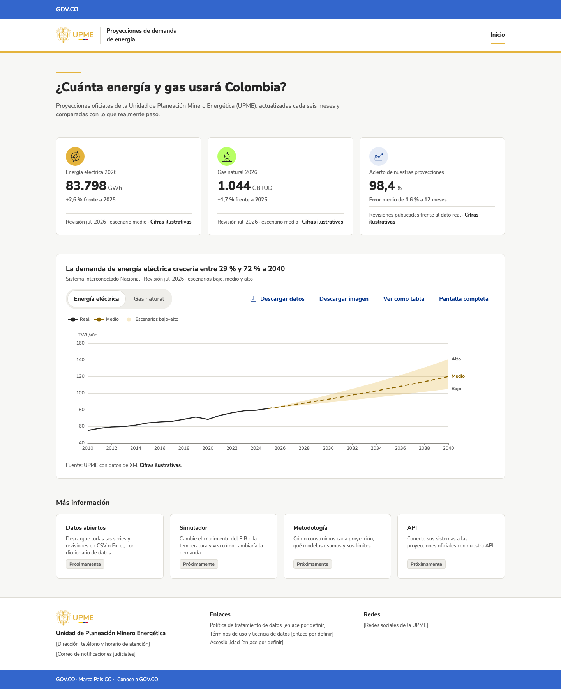

## Qué cambió
El portal público tiene su página de inicio, como en los mockups aprobados:
- barra GOV.CO, encabezado con el logo de la UPME y franja amarilla;
- la pregunta «¿Cuánta energía y gas usará Colombia?»;
- las cifras de energía eléctrica, gas natural y acierto de las proyecciones;
- el gráfico de la proyección vigente con escenarios bajo, medio y alto hasta 2040;
- cuatro secciones marcadas «Próximamente» y el pie con los datos de la entidad.

Todas las cifras son ilustrativas y lo dicen. Funciona en escritorio y en teléfono.

## Por qué
El portal y el modo pantalla son clave para presentar el proyecto (etapa 1.1). Con esta página ya se puede mostrar cómo verá el público las proyecciones.

## Cómo se ve

## Notas técnicas
- Vista `frontend/src/zones/portal/PortalHome.tsx`; cálculos (variación, rango de crecimiento, título con hallazgo) en `portalData.ts`, con pruebas.
- Componentes nuevos: `PublicHeader` (con `GovcoBar`) y `PublicFooter`, agregados a la galería.
- El menú superior solo muestra «Inicio»; las secciones sin página se ven como «Próximamente», sin enlace (decisión del líder, #13).
- ECharts por módulos (`echarts/core`); `ChartCard` con barra de acciones y tamaño táctil; modo `compact` del gráfico en teléfonos.
- Nuevo indicador ilustrativo `useAccuracy` en la capa de datos.
- Capturas de Playwright en escritorio y móvil; `BASE_URL` para capturar contra otro servidor.
- Pendientes: X-11 (logo de GOV.CO, datos de contacto, enlaces legales y redes) y nuevo X-14 (definición del acierto, cifras principales y licencia de los datos).
