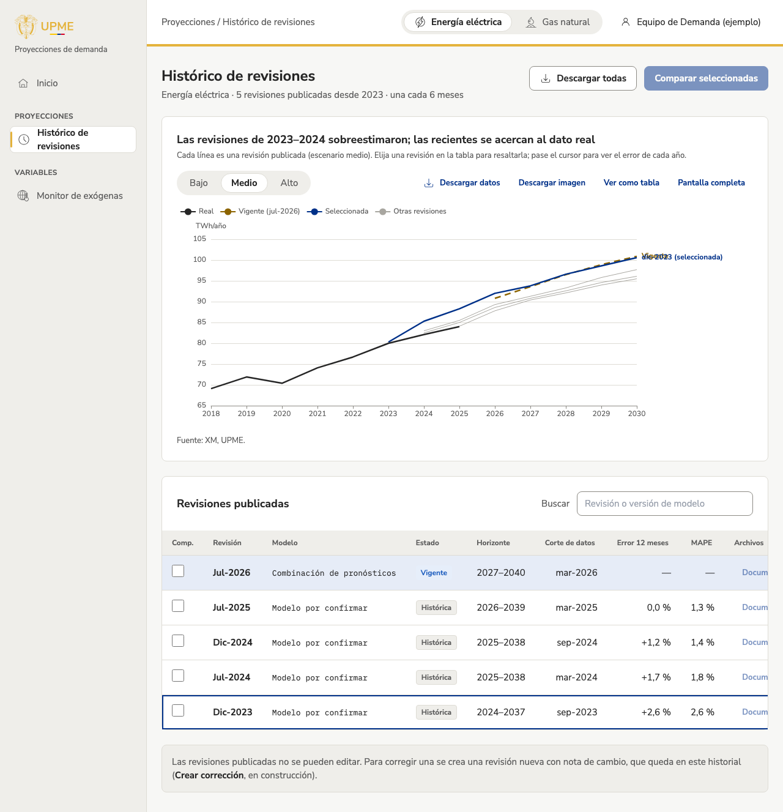

## Qué cambió
La app interna tiene el **histórico de revisiones**, como en el mockup aprobado:
- un gráfico con todas las revisiones publicadas, la vigente y la que el usuario elija resaltada;
- una tabla con cada revisión, su modelo, estado, horizonte, corte de datos, error a 12 meses y error medio;
- búsqueda, orden por columna y descarga de cada revisión o de todas.

Aparece en el menú lateral, en Proyecciones.

«Comparar seleccionadas» y «Documento» se ven pero están deshabilitados: la vista de comparar aún no existe (T-13) y los documentos oficiales todavía no se han cargado. Todas las cifras son ilustrativas.

## Por qué
Permite explicar cómo han cambiado las proyecciones y cuál fue la más acertada (T-10).

## Cómo se ve

## Notas técnicas
- `zones/app/RevisionHistory.tsx`, `components/charts/historyChart.ts` (abanico, tooltip con error y `historyTitle`), `lib/cssVar.ts` (color de la seleccionada desde el token `--primary`).
- Componente nuevo `DataTable` (orden, paginación de 25, fila vigente y fila elegida), en la galería.
- Datos: `error12` por revisión en el desempeño ilustrativo.
- Encabezado de la app con «Grupo / Vista»; ítem del menú activo; ruta del inventario alineada con el menú (`/app/proyecciones/historico`).
- Recorrido de Playwright ampliado (menú, selección, escenario, búsqueda) y captura con sesión simulada.
