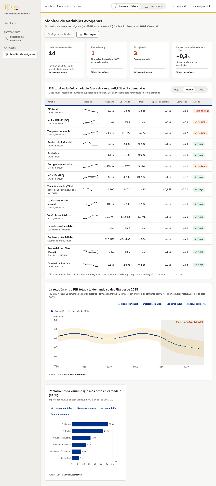

## Qué cambió
La app interna tiene el **monitor de variables exógenas**, como en el mockup aprobado:
- cuatro indicadores: variables monitoreadas, fuera de rango, en vigilancia e impacto estimado en la demanda del año;
- una tabla con cada variable: tendencia, supuesto de la revisión vigente, observado, desvío, impacto en la demanda, correlación y estado;
- un selector de escenario (bajo, medio, alto) que cambia supuestos, estados e indicadores;
- la relación de la variable elegida con la demanda (correlación móvil de 24 meses), con el quiebre detectado sombreado;
- qué variables pesan más en el modelo de la revisión vigente;
- descarga de la tabla en CSV.

Aparece en el menú lateral, en Variables. Las alertas del tablero ejecutivo («Ver variable», «Ver monitor») ahora llevan al monitor con la variable de la alerta.

«Configurar umbrales» se ve pero está deshabilitado: los umbrales están por definir (X-03). Todas las cifras son ilustrativas, y los estados usan umbrales de ejemplo.

## Por qué
Permite detectar a tiempo una variable que se aleja de lo que supuso la revisión vigente y estimar su efecto en la demanda (T-11).

## Cómo se ve

## Notas técnicas
- `zones/app/ExogenousMonitor.tsx`, `zones/app/exogenousData.ts` (desvío, estado, indicadores y títulos con hallazgo) y `components/charts/exogenousCharts.ts` (tendencia, correlación móvil con banda y quiebre, importancia).
- Componente nuevo `Sparkline`, en la galería; tono `warning` en `KpiCard`.
- Datos: `useExogenousMonitor(product)` con el tipo `ExogenousMonitor`. La app no calcula impactos, correlaciones ni importancias: llegan con la revisión o con una carga (T-17). Los campos que pidió la vista están en `docs/tecnica/frontend.md`, para T-16.
- Ruta `/app/variables/exogenas`; `isBuilt()` en `navigation.ts` habilita las acciones de las alertas cuando su vista existe.
- Recorrido de Playwright (menú, título, selección de variable, escenario, gas natural, descarga y enlace desde la alerta) y captura con sesión simulada.
