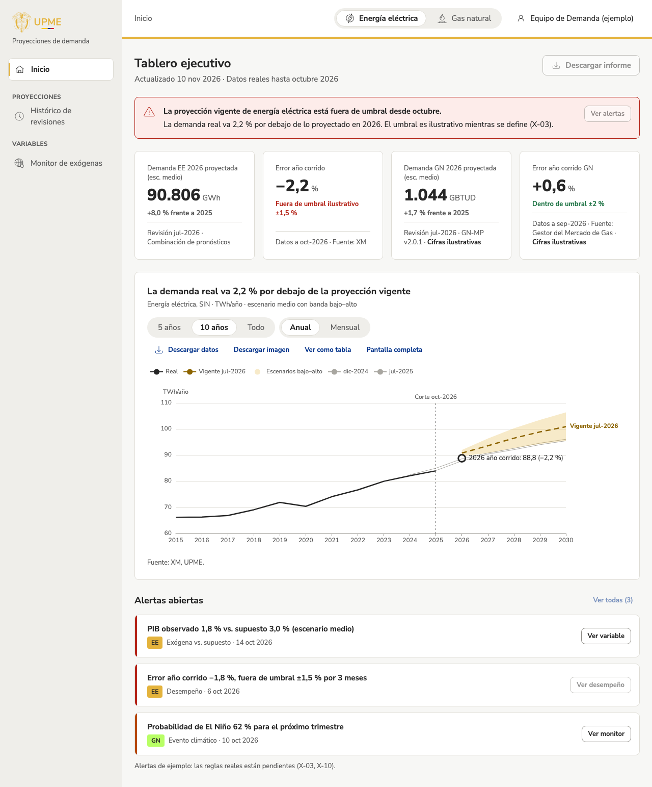

## Qué cambió
Al ingresar a la app interna ahora se ve el **tablero ejecutivo**, como en el mockup aprobado:
- un aviso rojo cuando la proyección vigente de un producto está fuera del umbral;
- las cifras de energía eléctrica y gas natural, con el error del año corrido;
- el gráfico de lo real frente a la proyección vigente, con las revisiones anteriores y el punto del año corrido;
- las alertas abiertas.

Todo con cifras de ejemplo.

«Descargar informe» se ve pero está deshabilitado («En construcción»), y los botones que llevan a vistas que aún no existen también. «Abrir revisión extraordinaria» quedó fuera: ejecutar proyecciones es fase 2 y la revisión extraordinaria aún no está definida.

También se corrigió que los años del eje del gráfico no se veían en el portal desde el modo pantalla.

## Por qué
Es la primera vista que responde la pregunta principal del equipo: si la proyección vigente sigue siendo válida (T-09).

## Cómo se ve

## Notas técnicas
- `zones/app/ExecutiveDashboard.tsx` como ruta índice de `/app` (reemplaza `AppHome`); `dashboardData.ts` (rango y año corrido) y `lib/insights.ts` (cálculos compartidos con el modo pantalla, movidos desde `zones/pantalla/kioskData.ts`).
- Componentes nuevos `Banner` y `AlertItem`, en la galería. `projectionChart` acepta `ytdPoint` (marca sobre la línea real).
- Datos: alertas de ejemplo (`useAlerts`), sin reglas reales (X-03, X-10).
- Corrección: `projectionChart` pasaba `axisLabel: undefined` fuera del modo pantalla y eso borraba las etiquetas del eje que pone el tema (entró con el PR #16). Ahora esas claves solo se agregan con `kiosk`; hay una prueba que lo verifica.
- Inventario: `tablero-ejecutivo` completa; `app-inicio` pasa a «retirada». Capturas con sesión simulada. La captura retirada `app-inicio.png` se conserva para el diario en `docs/diario/2026/capturas/2026-11-08-app-interna.png`.
- Pendientes nuevos: X-18 (revisión extraordinaria) y X-19 (informe del tablero).
