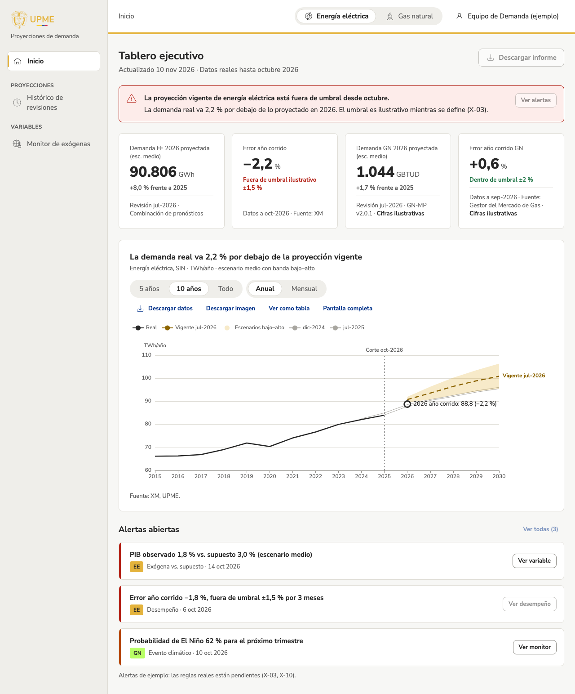
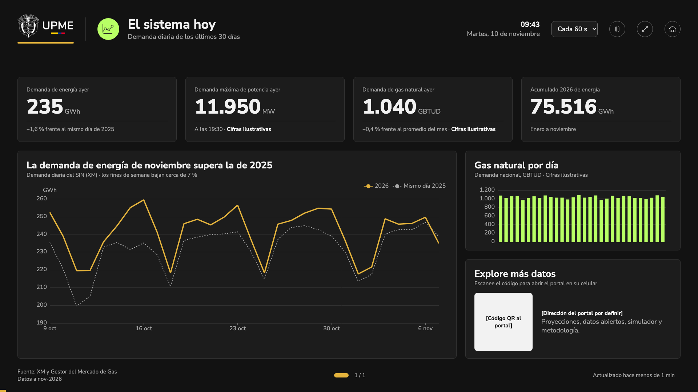

## Qué cambió
Las vistas ya muestran **datos reales de energía eléctrica**: las revisiones publicadas por la UPME y la demanda real del SIN que publica XM. Lo están haciendo cuatro vistas:
- el tablero ejecutivo;
- el histórico de revisiones;
- el inicio del portal;
- el modo pantalla.

Es una conexión **provisional**, para ver datos reales de una vez mientras se toman las decisiones definitivas (T-32 a T-34):
- Las vistas siguen diciendo «escenario bajo, medio y alto». Para energía eléctrica, el bajo y el alto son los límites del intervalo de confianza del 68 % de cada revisión, porque la UPME publica un escenario medio con intervalos y no escenarios bajo y alto.
- Solo se muestra la serie SIN+GCE+ME+GD_UPME, la que se compara con el dato real.
- Los indicadores de error son los que ya tenían las vistas. El umbral de ±1,5 % sigue siendo ilustrativo y ahora lo dice.

Las gráficas de proyección de energía eléctrica se pueden ver **por año o por mes** con un control «Anual / Mensual». Por omisión siguen anuales, como los diseños aprobados. En mensual se ve la estacionalidad de la demanda y, mes a mes, cómo va el dato real frente a lo proyectado.

Lo que todavía no tiene datos reales sigue con cifras de ejemplo, y cada gráfico o tarjeta lo dice:
- gas natural;
- el monitor de exógenas;
- las alertas;
- el acierto de las proyecciones;
- en «El sistema hoy», la demanda máxima de potencia y el gas.

## Por qué
Para revisar las vistas con datos verdaderos antes de decidir cómo se muestran los intervalos, las métricas de error y los umbrales (fase 4 del plan de datos).

## Cómo se ve

## Notas técnicas
- **API:** `backend/app/api/v1/ee.py`, solo lectura sobre las vistas de `core`, sin ingreso. Documentada en [API](../../tecnica/api.md), con sus decisiones provisionales y cómo se calcula cada indicador.
- **Frontend:**
    - `data/source.ts` decide por dato: energía eléctrica desde la API y lo demás desde `demo/`;
    - el aviso de ilustrativo va por respuesta;
    - los tipos de la API se generan con `pnpm gen:api` (TEC-08).
- **Lo que mostraron los datos reales:**
    - el texto completo del modelo de 2026-07 no cabía en las vistas, así que la API devuelve un nombre corto («Combinación de pronósticos»);
    - XM publicó el 2026-11-08 a medias (0,6 GWh) y entró como aceptado, porque aún no hay reglas de anomalía; «El sistema hoy» omite esos días y quedó como evidencia en X-24.
- **Primeras cifras:**
    - con la revisión vigente (jul-2026), la demanda real de abril a octubre de 2026 va 2,2 % por debajo de lo proyectado;
    - la revisión con menor error a 12 meses es jul-2025 (MAPE 1,3 %).
- **Resolución mensual:** la API acepta `frequency=M` en el dato real (solo meses completos) y en los valores de una revisión (desde su primer mes proyectado). En el frontend, `lib/resolution.ts`. En el modo pantalla, el control va en el encabezado de la gráfica principal, porque en la fila de filtros no cabía a 1920 px.
- **Capturas:** regeneradas con los datos reales (DOC-03), con la marca de ilustrativo solo en lo que sigue siendo de ejemplo.
