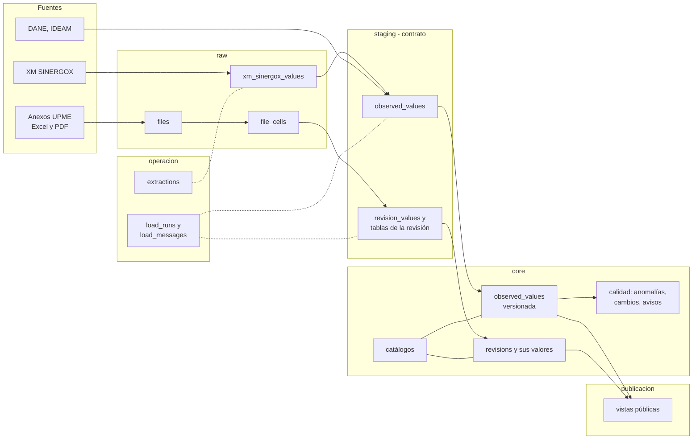

# Base de datos

Cómo está organizada la base `proyecciones_demanda` (PostgreSQL 16, BD-01): qué guarda cada esquema, cómo llega un dato desde su fuente hasta la app, y con qué reglas. Cada esquema tiene su página, y cada tabla su explicación y ejemplos (PBD-02).

!!! note "Estado"
    Esta sección describe el **modelo de datos v2**, aprobado el 2026-11-10 ([P-0004](../../decisiones/0004-modelo-datos-v2.md)) y creado con la migración `0003` (T-23). Están sembrados los catálogos fijos; los datos reales llegan desde T-24. Cada columna, con su tipo y comentario, está en el [diccionario](diccionario.md).

## Los esquemas

| Esquema | Qué guarda | Quién lo escribe | Quién lo lee | Página |
| --- | --- | --- | --- | --- |
| `raw` | Los datos tal como llegan de cada fuente, sin limpiar | Los flujos de carga | Solo los flujos de carga | [raw](raw.md) |
| `staging` | Los datos validados y normalizados, con la misma forma para todas las fuentes (el contrato) | Los flujos de carga | Solo los flujos de carga | [staging](staging.md) |
| `core` | Las entidades del producto: catálogos, revisiones publicadas, datos reales versionados y su calidad | Los flujos de carga y las decisiones de las personas | La API y las vistas internas | [core](core.md) |
| `publicacion` | Solo lo que se puede mostrar en público | Vistas sobre `core` | La API pública, el portal y el modo pantalla | [publicacion](publicacion.md) |
| `auth` | Usuarios, roles y su asignación | El módulo de autenticación | La API | [auth](auth.md) |
| `operacion` | Cómo funciona el sistema: bitácora de cargas, mensajes, extracciones, estado de las fuentes | Los flujos de carga | Personas que revisan las cargas | [operacion](operacion.md) |

Los cinco primeros son los de BD-03. `operacion` es propio de este proyecto (PBD-07) y está propuesto al estándar ([X-22](../../pendientes/x-22-reglas-al-estandar.md)).

## Recorrido de un dato

**Ejemplo con la demanda de XM.** La carga diaria del 10-nov consulta a XM los últimos 10 días de `DemaSIN`:

1. **Registra la consulta** en `operacion.extractions`: qué se pidió, cuándo, la respuesta y la huella del contenido.
2. **Guarda en `raw.xm_sinergox_values`** lo que llegó tal cual: valores en texto, en kWh, con los nombres de XM. Solo si el contenido cambió frente a la última consulta igual.
3. **Normaliza en `staging.observed_values`:** convierte a GWh, pone los códigos de los catálogos (`xm_demasin`, `ee_sin`, frecuencia `D`) y aplica las reglas de anomalía de la ficha.
4. **Pasa a `core.observed_values`:** compara cada día con su versión vigente. Si el 8-nov llegó completo y antes estaba incompleto, crea la versión 2 y registra el cambio en `core.observed_changes`. Si no cambió nada, no escribe nada.
5. **Deja su fila en `operacion.load_runs`:** «10 días consultados, 1 cambiado, 9 sin cambio, 0 anómalos».

Las vistas leen `core` (y el público, `publicacion`). Ninguna lee `raw`, y por eso cambiar el origen de una fuente no las toca (PDA-01).

**Ejemplo con un anexo de la UPME.** El archivo de la revisión 2026-07 se guarda completo en `raw.files` y celda por celda en `raw.file_cells`. El lector ubica las series por sus encabezados, verifica que los componentes sumen y que el anual sea la suma de los meses (PDA-06), normaliza el signo de la GD (PDA-07) y deja los valores en `staging`. Si todo cuadra, entran a `core.revisions` y sus tablas; si no, la carga falla con un mensaje en `operacion.load_messages`.

## Ideas del modelo

1. **Lo que cambia entre productos es un catálogo:** medida, geografía, serie o sector, componente, tipo de valor, variable y fuente. Por eso energía eléctrica y gas natural usan las mismas tablas.
2. **Lo observado es una sola tabla versionada** para cualquier fuente y variable, con versión y fecha de carga (PBD-05) y estado de calidad (PDA-02).
3. **Las cifras de una revisión publicada no se modifican nunca.** Se corrigen con una revisión nueva (P-0003). Sus metadatos (enlace, fecha, modelo, notas) sí se completan o corrigen, con registro del cambio (PBD-08).
4. **Lo oficial no se mezcla con lo experimental** (PBD-06).

## En esta sección

- Esquemas: [raw](raw.md) · [staging](staging.md) · [core](core.md) · [publicacion](publicacion.md) · [auth](auth.md) · [operacion](operacion.md)
- [Convenciones](convenciones.md): nombres, comentarios, valores permitidos, procedencia, fechas y números.
- [Vistas para revisar y analizar](vistas.md): las tablas anchas para mirar a ojo, Excel o Power BI.
- [Fuentes de datos](fuentes/index.md): guía de cada entidad y ficha de cada fuente.
- [Diccionario](diccionario.md): cada tabla, vista y columna con su tipo y comentario, generado desde la base (PBD-03).
