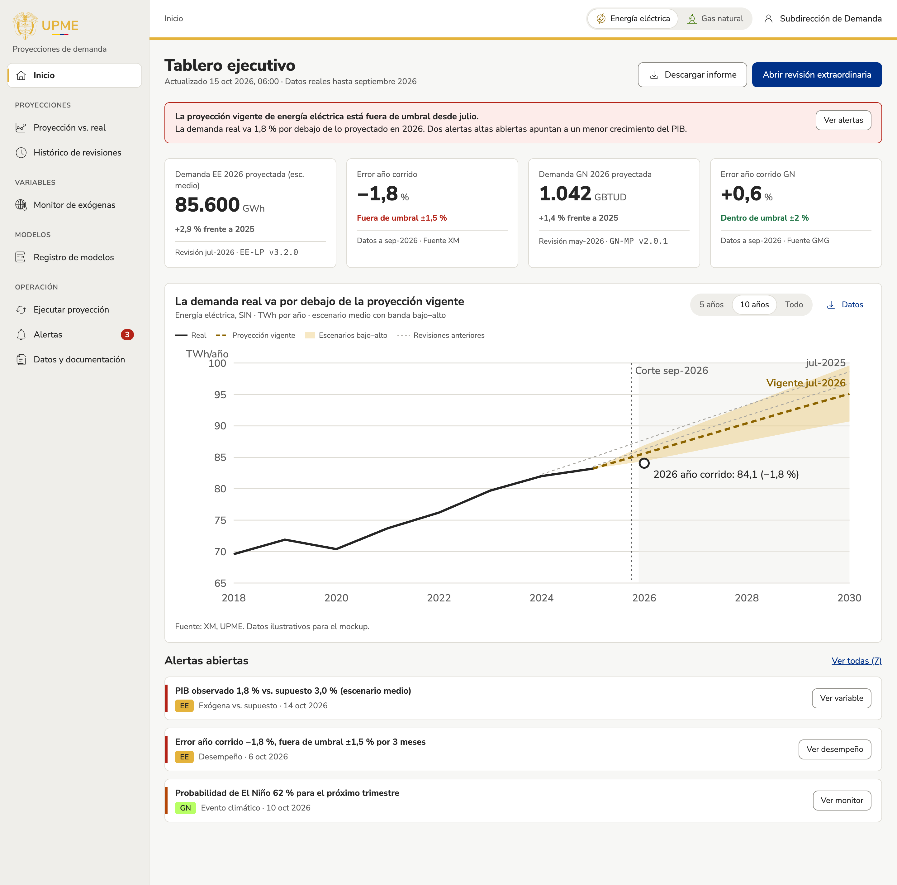
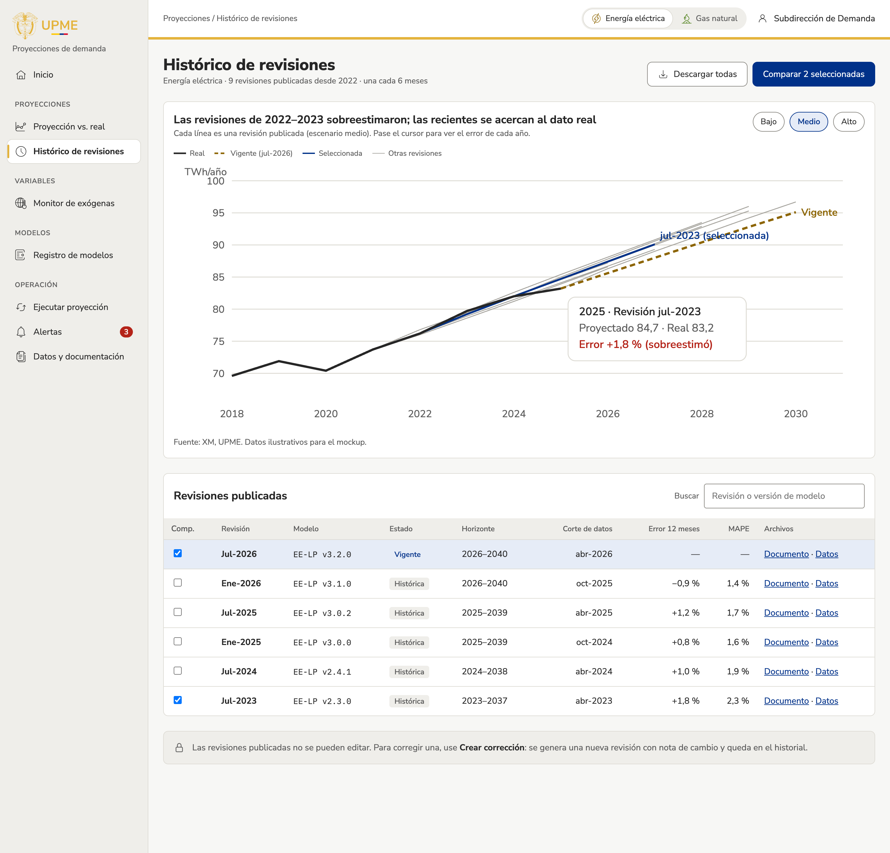
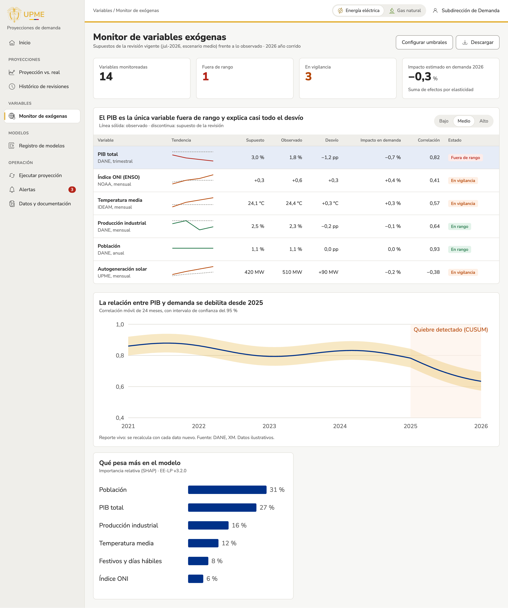
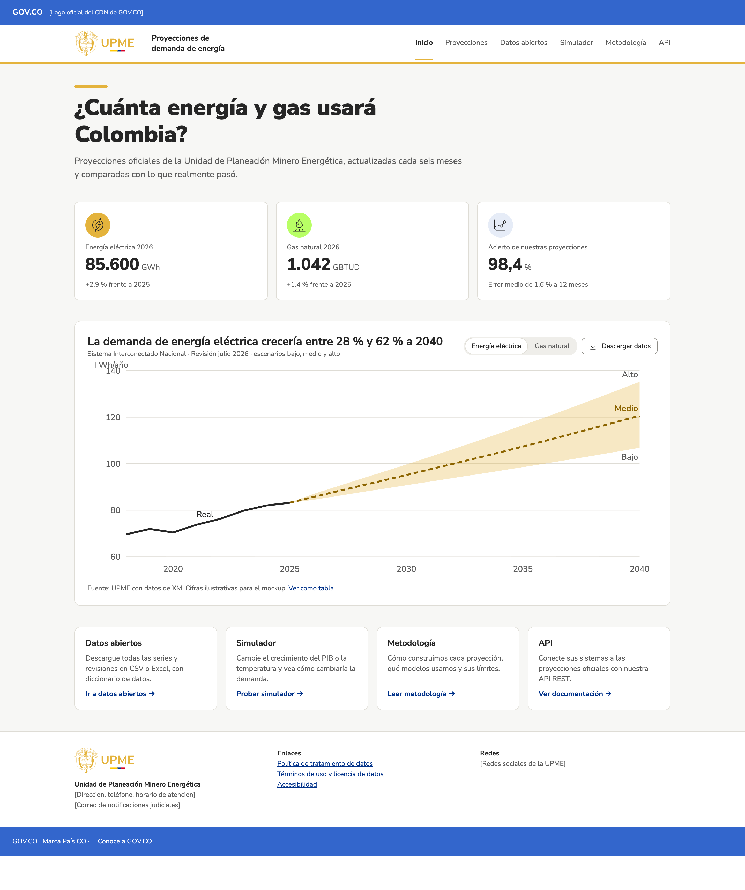
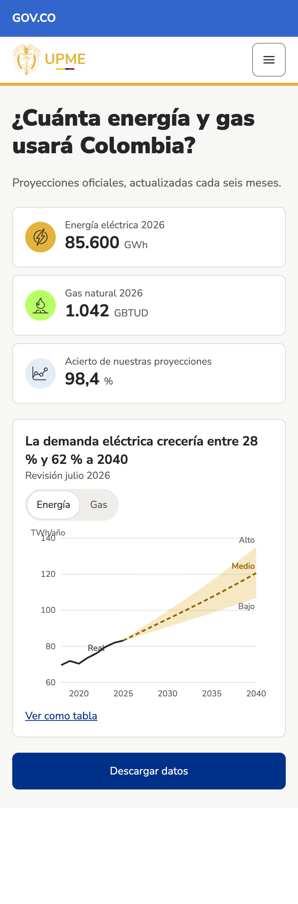
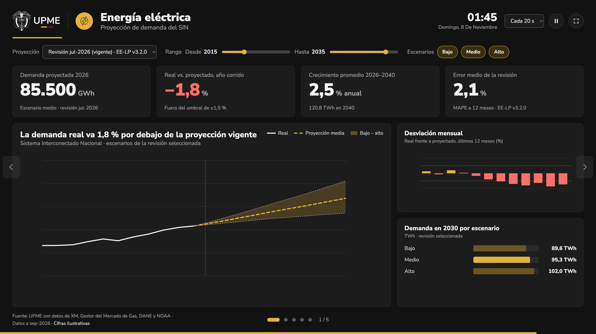
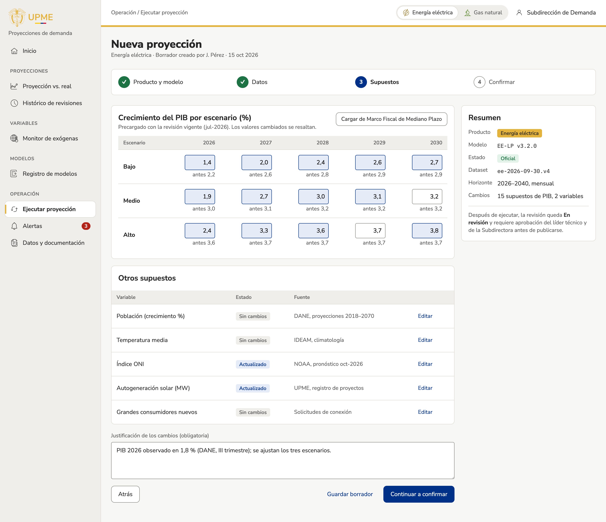
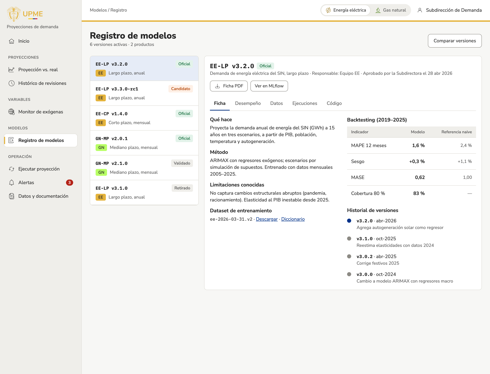

# Mockups aprobados

Capturas congeladas de los diseños aprobados de cada vista (FLU-03). Son la referencia para desarrollar y revisar: si la vista implementada se aparta de su captura, o hay que corregir el diseño, se aprueba un mockup nuevo y se actualiza esta carpeta.

## Registro de aprobación

| Campo | Valor |
| --- | --- |
| Aprobó | David Bedoya, líder del equipo de la Subdirección de Demanda |
| Fecha de aprobación | 2026-11-08 |
| Fuente | Tablero «Mockups – Plataforma de Proyecciones de Demanda UPME»: https://claude.ai/artifact/DJrR79dHKDgYv77oe9b3sX |
| Versión del tablero | `1794013847-6236` |
| Sistema de diseño | «Proyecciones de Demanda UPME» (namespace `upme`) |
| Capturas exportadas | 2026-11-08 |
| Subidas al repositorio | 2026-11-08 |

Todas las cifras de las capturas son **ilustrativas**: muestran formato, jerarquía y comportamiento, no datos oficiales. Si un mockup contradice `reglas/REGLAS-DISENO.md` o `reglas/MARCA-UPME.md`, manda el estándar (ver `docs/tecnica/diseno-app.md`).

## Capturas

| Archivo | Vista (inventario) | Zona | Etapa |
| --- | --- | --- | --- |
| `tablero-ejecutivo.png` | `tablero-ejecutivo` | app | 1 |
| `historico-revisiones.png` | `historico-revisiones` | app | 1 |
| `monitor-exogenas.png` | `monitor-exogenas` | app | 1 |
| `portal-inicio-escritorio.png` | `portal-inicio` | portal | 1.2 |
| `portal-inicio-movil.png` | `portal-inicio` | portal | 1.2 |
| `modo-pantalla.png` | `modo-pantalla` | pantalla | 1.2 |
| `ejecutar-proyeccion-supuestos.png` | `ejecutar-proyeccion` | app | 2 |
| `registro-modelos.png` | `registro-modelos` | app | 2 |

Los nombres siguen el `id` de la página de inventario (`docs/usuario/inventario/<id>.md`); un sufijo distingue variantes de la misma vista (escritorio/móvil, paso de un asistente).

### Tablero ejecutivo — `tablero-ejecutivo.png`

Vista de inicio de la app interna. Encabezado con selector de producto (Energía eléctrica / Gas natural) y menú lateral por secciones (Proyecciones, Variables, Modelos, Operación). Muestra un aviso cuando la proyección vigente está fuera de umbral, cuatro indicadores (demanda proyectada y error año corrido de EE y GN, con revisión, versión de modelo y fuente), el gráfico real frente a la proyección vigente con banda de escenarios bajo–alto, revisiones anteriores y fecha de corte, y la lista de alertas abiertas con acceso a su detalle. Acciones: descargar informe y abrir revisión extraordinaria.

### Histórico de revisiones — `historico-revisiones.png`

Todas las revisiones publicadas de un producto. Gráfico con el dato real, la revisión vigente, la seleccionada y las demás (filtro por escenario bajo/medio/alto; al pasar el cursor muestra proyectado, real y error de un año). Tabla con revisión, modelo, estado, horizonte, corte de datos, error a 12 meses, MAPE y enlaces a documento y datos; casillas para comparar dos revisiones. Indica que las revisiones publicadas no se editan: se corrigen con una revisión nueva (relacionado con X-09).

### Monitor de variables exógenas — `monitor-exogenas.png`

Supuestos de la revisión vigente frente a lo observado. Indicadores: variables monitoreadas, fuera de rango, en vigilancia e impacto estimado en la demanda. Tabla por variable (fuente y frecuencia, tendencia, supuesto, observado, desvío, impacto, correlación y estado), gráfico de correlación móvil entre PIB y demanda con quiebre detectado, e importancia relativa de las variables en el modelo. Acciones: configurar umbrales (depende de X-03) y descargar.

### Portal público, escritorio — `portal-inicio-escritorio.png`

Inicio del portal para entidades, empresas y ciudadanía, con barra GOV.CO. Pregunta principal, cifras de EE y GN del año y acierto de las proyecciones; gráfico de la revisión publicada con escenarios bajo, medio y alto hasta 2040, descarga de datos y vista como tabla; accesos a datos abiertos, simulador, metodología y API; pie con enlaces legales. Los textos entre corchetes (logo del CDN de GOV.CO, dirección, redes) son marcadores por completar.

### Portal público, móvil — `portal-inicio-movil.png`

La misma vista a 390 px: menú colapsado, indicadores apilados, gráfico con selector Energía/Gas, enlace a la tabla y botón de descarga a todo el ancho.

### Modo pantalla — `modo-pantalla.png`

Tableros rotativos para televisores (1920×1080, tema oscuro). Encabezado con producto, hora y fecha, intervalo de rotación, pausa y pantalla completa; filtros de revisión, rango de años y escenarios; indicadores de demanda, desvío, crecimiento y error; gráfico real frente a proyección con banda de escenarios, desviación mensual y demanda a 2030 por escenario. Navegación con flechas y puntos (1 de 5). En el tablero rota cada 20 s y cualquier interacción pausa la rotación 30 s.

### Ejecutar proyección, paso 3 — `ejecutar-proyeccion-supuestos.png`

Fase 2. Asistente de cuatro pasos (producto y modelo, datos, supuestos, confirmar); la captura muestra el paso de supuestos: crecimiento del PIB por escenario y año, precargado con la revisión vigente y con los cambios resaltados; otros supuestos con estado y fuente; justificación obligatoria y resumen (producto, modelo, dataset, horizonte, cambios). Indica que la revisión ejecutada queda en revisión y requiere aprobación del líder técnico y de la Subdirectora (relacionado con X-05).

### Registro de modelos — `registro-modelos.png`

Fase 2. Lista de versiones de modelos por producto con su estado (oficial, candidato, validado, retirado) y ficha de la versión seleccionada: qué hace, método, limitaciones, dataset de entrenamiento, backtesting frente a una referencia ingenua e historial de versiones; pestañas de desempeño, datos, ejecuciones y código; enlaces a la ficha PDF y a MLflow.

## Vistas sin mockup aprobado

- `proyeccion-vs-real`, `comparar-revisiones` y `administracion-usuarios`: no tienen tablero en el mockup; siguen pendientes (X-06).
- `app-inicio` e `ingresar`: diseño pendiente.
- El menú de los mockups incluye **Alertas** y **Datos y documentación**, que aún no tienen página en el inventario.

## Cómo actualizar

1. Aprobar el cambio de diseño (FLU-03) y registrarlo en el issue de la vista.
2. Reemplazar la captura con el mismo nombre y actualizar en este archivo la fecha, quien aprobó y la versión del tablero.
3. Actualizar el campo `diseno:` de la página del inventario y anotar el cambio en `CHANGELOG.md` y en `docs/diario/`.
