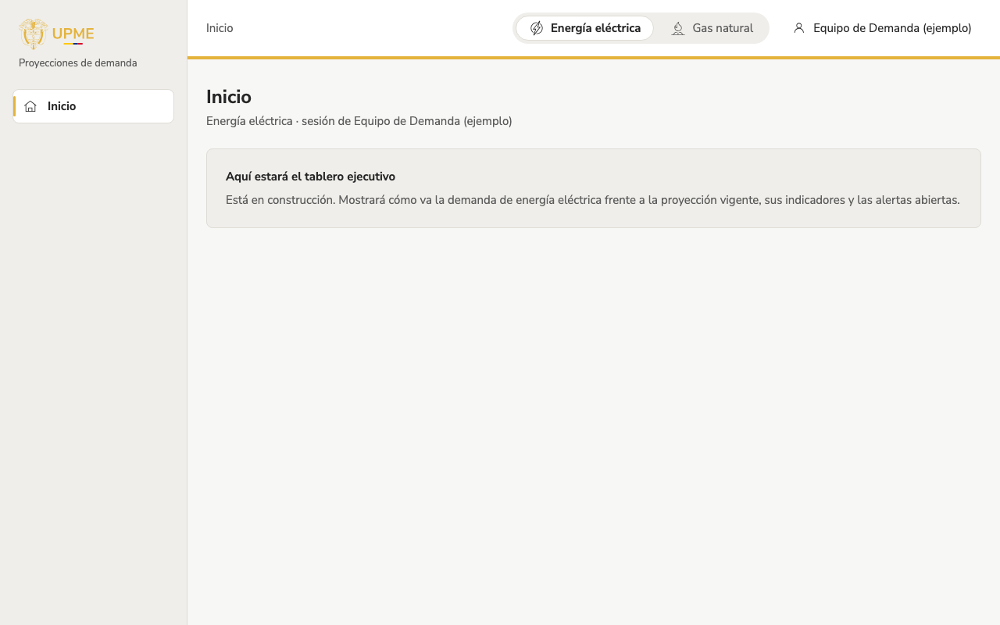
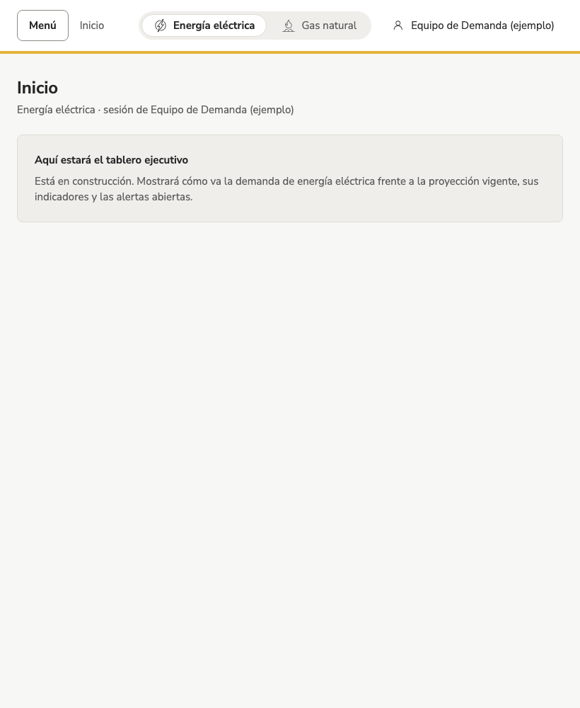

# Inicio de la app interna

## Para qué sirve
Es la entrada a las herramientas internas de la Subdirección de Demanda. Hoy muestra la estructura común de la app (menú, producto y usuario); el **tablero ejecutivo** ocupará este inicio cuando esté listo.

## Cómo llegar
- Desde el portal público: **Ingresar**, a la derecha del menú superior (en el teléfono, dentro de «Menú»).
- Directamente: `/app`.

Si no hay sesión, primero se pide ingresar con la cuenta institucional o con un usuario local, y luego se vuelve a la página que se pidió.

## Qué muestra
- **Menú lateral:** el logo y las secciones de la app. Solo aparecen las vistas que ya existen y las que su rol puede usar; las demás se irán sumando.
- **Encabezado:** dónde está, el **producto** con el que trabaja (energía eléctrica o gas natural) y su nombre.
- **Contenido:** el título de la vista y, por ahora, un aviso de que el tablero ejecutivo está en construcción.

## Cómo se usa (paso a paso)
1. Elija el producto en el encabezado. Se mantiene al pasar de una vista a otra y queda en la dirección de la página, así que se puede compartir.
2. Use el menú lateral para ir a cada vista.
3. Toque su nombre, arriba a la derecha, para ver sus roles, **Ir al portal público** o **Cerrar sesión**.

En pantallas medianas (tablet), el menú lateral se oculta y se abre con el botón **Menú**; se cierra al elegir una opción, al tocar fuera o con la tecla Esc.

{ width="420" }

## Filtros y opciones
| Opción | Qué hace |
| --- | --- |
| Energía eléctrica / Gas natural | Producto activo de toda la app (`?producto=ee` o `?producto=gn`). |
| Menú del usuario | Nombre, correo y roles; ir al portal público; cerrar sesión. |

## Preguntas frecuentes
**¿Por qué el menú tiene tan pocas opciones?** Solo muestra las vistas que ya existen y que su rol puede usar. A medida que se construyan aparecerán el histórico de revisiones, el monitor de variables exógenas y las demás.

**Ingresé y dice «Sin permiso».** Su usuario no tiene el rol necesario. Pídaselo a un administrador del equipo de la Subdirección de Demanda.

## Historial
- 2026-11-08: estructura de la app interna y acceso desde el portal (diario técnico: `2026-11-08-app-interna`).
