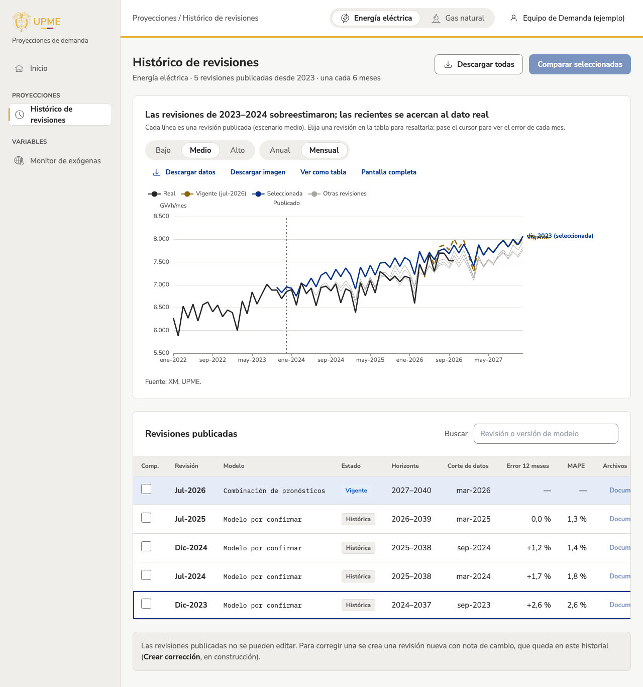

# Histórico de revisiones

!!! warning "Datos reales provisionales y cifras ilustrativas"
    **Energía eléctrica ya muestra datos reales** (desde T-37): las revisiones publicadas por la UPME (serie SIN+GCE+ME+GD_UPME) y la demanda del SIN de XM. Es una conexión **provisional**: los escenarios «bajo» y «alto» son los límites del intervalo de confianza del 68 % de la revisión, porque la UPME publica para energía eléctrica un escenario medio con intervalos y no escenarios bajo y alto. Los indicadores de error son provisionales y el umbral es ilustrativo (X-03, X-25).

    Gas natural sigue con cifras de ejemplo, y lo dice junto al gráfico.

## Para qué sirve
Muestra **todas las revisiones publicadas** de un producto, cómo cambiaron con el tiempo y **qué tan acertada fue cada una** frente al dato real. Sirve para explicar la evolución de las proyecciones y para descargar cualquier revisión.

## Cómo llegar
Menú lateral: **Proyecciones › Histórico de revisiones**, o `/app/proyecciones/historico`.

## Qué muestra
- **Gráfico:** el dato real (línea negra), cada revisión publicada en línea fina gris, la vigente discontinua y la revisión que usted elija resaltada en azul. El título resume qué tan acertadas fueron.
- **Tabla de revisiones publicadas:** revisión, versión del modelo, estado (Vigente o Histórica), horizonte, fecha de corte de los datos, error en los 12 meses siguientes a su publicación (positivo: sobreestimó), error medio (MAPE) y archivos. La vigente aparece resaltada; aún no tiene 12 meses para medir su error.
- **Aviso:** las revisiones publicadas no se editan; se corrigen con una revisión nueva.

## Cómo se usa (paso a paso)
1. Elija el producto en el encabezado y el escenario (**Bajo**, **Medio** o **Alto**) sobre el gráfico.
2. Toque una fila de la tabla para resaltar esa revisión en el gráfico; tóquela otra vez para quitarla.
3. Pase el cursor sobre el gráfico: para cada año ve lo proyectado, lo real y el error de la revisión resaltada (o de la vigente).
4. Busque por revisión («jul-2023») o por versión del modelo («v3.2»).
5. Toque el título de una columna para ordenar la tabla.
6. Descargue una revisión con **Datos**, o todas con **Descargar todas**.

## Filtros y opciones
| Opción | Qué hace |
| --- | --- |
| Bajo / Medio / Alto | Escenario de todas las revisiones en el gráfico (`?escenario=high`). |
| Anual / Mensual | Muestra el gráfico por mes (GWh/mes, por omisión) o por año (TWh/año). En mensual se ve la estacionalidad y el detalle real frente a proyectado mes a mes, y el gráfico abre alrededor de la revisión: desde un año antes de su publicación hasta un año después del último dato real (para la revisión jul-2026 con datos a oct-2026, de 2025 a 2027). Una línea vertical marca el mes de publicación («Publicado») y otra el corte del dato real. Solo energía eléctrica: gas natural siempre se ve anual. Queda en la dirección (`?resolucion=anual`). La línea «Publicado» y el rango en mensual siguen a la revisión resaltada: la vigente o la elegida en la tabla. |
| Fila de la tabla | Resalta la revisión en el gráfico (`?revision=2023-12`). |
| Buscar | Filtra la tabla por revisión o modelo. |
| Descargar todas | CSV con todas las revisiones y escenarios. |
| Datos | CSV con los tres escenarios de esa revisión. |
| Comparar seleccionadas | **En construcción** (vista Comparar revisiones); las casillas ya permiten elegir. |
| Documento | **Por cargar**: el documento oficial de cada revisión. |

## Preguntas frecuentes
**¿Qué significa «Error 12 meses»?** Cuánto se alejó la revisión de la demanda real en el año siguiente a su publicación. Positivo: proyectó más de lo que pasó (sobreestimó).

**¿Qué es el MAPE?** El error medio absoluto en porcentaje: cuánto se equivocó en promedio, sin importar el signo. Menos es mejor.

**¿Puedo corregir una revisión?** No se editan. Una corrección se publica como una revisión nueva, que queda en este historial.

## Historial
- 2026-11-09: primera versión con cifras ilustrativas (diario técnico: `2026-11-09-historico-revisiones`).
- 2026-11-10: energía eléctrica con datos reales, de forma provisional, y gráfica anual o mensual (T-37, issue #40; diario técnico: `2026-11-10-datos-reales-ee`).
