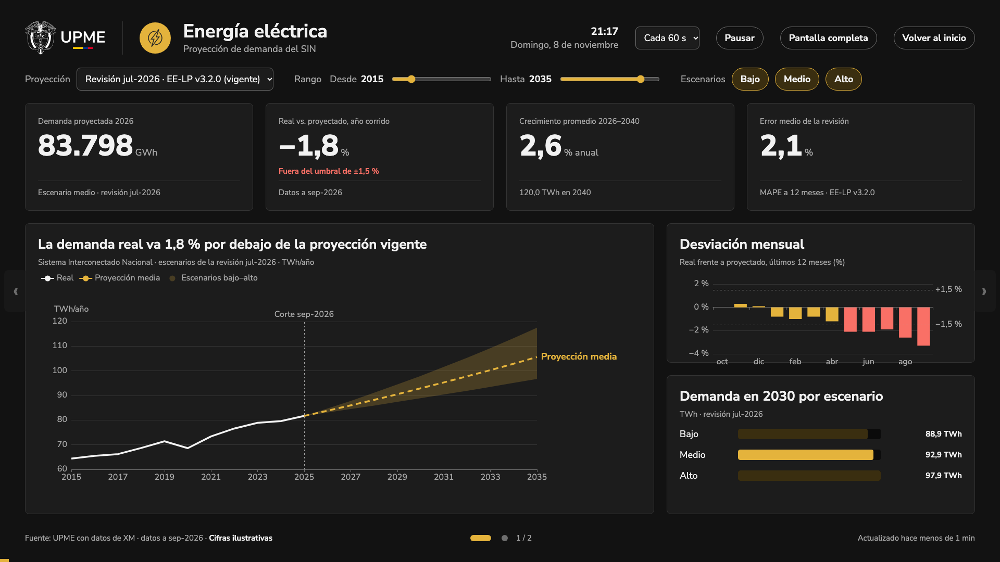

# Modo pantalla

!!! warning "Cifras ilustrativas"
    Mientras se cargan los datos oficiales, las cifras de los tableros son de ejemplo y lo dice el pie de la pantalla.

## Para qué sirve
Muestra las proyecciones de demanda en **televisores y monitores** de la UPME (recepción, salas, eventos), en tableros que rotan solos. Responde de un vistazo y a distancia cómo va la demanda real frente a la proyección vigente. Solo muestra datos públicos.

## Cómo llegar
- Desde el inicio del portal: **Ver en modo pantalla →**, junto al gráfico principal (en computador), o **Modo pantalla para televisores**, en el pie de página.
- Directamente: `/pantalla`.

Para dejarlo fijo en un televisor, abra la dirección en el navegador del equipo y use **Pantalla completa**.

## Qué muestra
Un tablero por producto: **energía eléctrica** y **gas natural**. Cada tablero tiene:

- **Encabezado:** producto, hora y fecha, y los controles de la pantalla.
- **Filtros:** la revisión, el rango de años y los escenarios que se ven.
- **Cuatro cifras:**
    - la demanda proyectada del próximo año;
    - cuánto va la demanda real por encima o por debajo de lo proyectado en el año corrido, y si está dentro del umbral aceptado;
    - el crecimiento promedio anual hasta 2040;
    - el error medio de la revisión.
- **Gráfico principal:** dato real (línea sólida), proyección media (línea discontinua) y banda entre los escenarios bajo y alto, con la fecha de corte de los datos.
- **Desviación mensual:** barras de los últimos 12 meses; en rojo, los meses fuera del umbral.
- **Demanda en 2030 por escenario.**
- **Pie:** fuente, puntos para cambiar de tablero y estado («Actualizado hace…», o la pausa).

## Cómo se usa (paso a paso)
1. Abra `/pantalla` y active **Pantalla completa**.
2. Los tableros cambian solos cada 20 segundos; la barra amarilla de abajo muestra cuánto falta.
3. Para ver otro tablero, toque los **puntos** del pie, las **flechas** laterales o **arrastre** la pantalla hacia un lado.
4. Al tocar cualquier cosa, la rotación se detiene 30 segundos («Pausa por interacción · continúa en N s»).
5. Si nadie toca la pantalla por 5 minutos, los filtros vuelven a sus valores iniciales.
6. Para salir, toque **Salir de pantalla completa** (o la tecla Esc) y luego **Volver al inicio**, que lleva a la página de inicio del portal. «Volver al inicio» también sale de la pantalla completa.

## Filtros y opciones
| Opción | Qué hace |
| --- | --- |
| Proyección | Elige la revisión que se compara; por defecto, la vigente. |
| Rango (Desde / Hasta) | Años que se ven en el gráfico principal; por defecto, 2015–2035. |
| Escenarios (Bajo, Medio, Alto) | Muestra u oculta cada escenario. Con bajo y alto se ve la banda. |
| Cada 10 / 20 / 30 / 60 s | Tiempo de cada tablero. |
| Pausar / Reanudar | Detiene la rotación hasta volver a tocar el botón. |
| Pantalla completa / Salir de pantalla completa | Ocupa toda la pantalla del televisor, o vuelve a la ventana normal. |
| Volver al inicio | Sale del modo pantalla y vuelve al inicio del portal. |

**Configuración por dirección**, para dejar una pantalla lista sin tocarla:

| Dirección | Resultado |
| --- | --- |
| `/pantalla` | Energía eléctrica y gas natural, cada 20 s |
| `/pantalla?tableros=gn` | Solo gas natural |
| `/pantalla?tableros=ee,gn&intervalo=60` | Ambos tableros, cada 60 s |

## Preguntas frecuentes
**¿Qué pasa si se cae internet?** La pantalla sigue mostrando los últimos datos y el pie dice «Sin conexión · últimos datos de hace N». Se actualiza sola cuando vuelve la conexión (cada 15 minutos lo intenta).

**¿Muestra información interna?** No. Solo datos publicados: nunca alertas, borradores ni pruebas.

**¿Funciona en cualquier televisor?** Está diseñado para pantallas de 1920 × 1080 y se ajusta a cualquier pantalla de formato 16:9.

## Historial
- 2026-11-08: primera versión con cifras ilustrativas: tableros de energía eléctrica y gas natural (diario técnico: `2026-11-08-modo-pantalla`).
