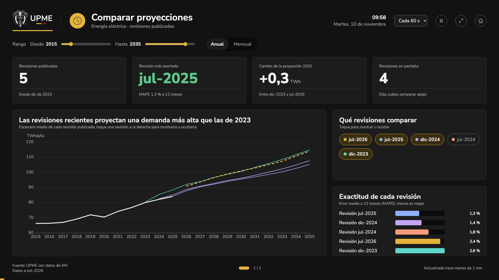
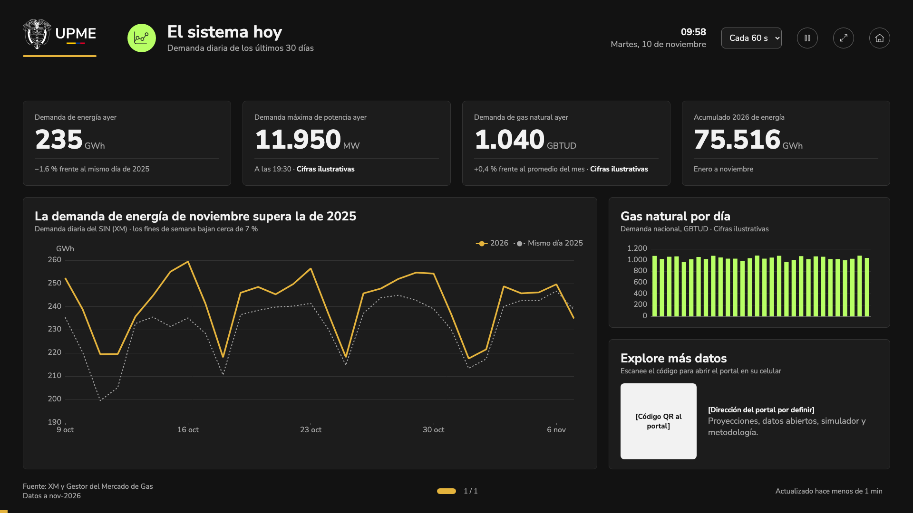

# Modo pantalla

!!! warning "Datos reales provisionales y cifras ilustrativas"
    **Energía eléctrica ya muestra datos reales** (desde T-37): las revisiones publicadas por la UPME (serie SIN+GCE+ME+GD_UPME) y la demanda del SIN de XM. Es una conexión **provisional**: los escenarios «bajo» y «alto» son los límites del intervalo de confianza del 68 % de la revisión, porque la UPME publica para energía eléctrica un escenario medio con intervalos y no escenarios bajo y alto. Los indicadores de error son provisionales y el umbral es ilustrativo (X-03, X-25).

    Siguen con cifras de ejemplo el tablero de gas natural y, en «El sistema hoy», la demanda máxima de potencia y el gas; lo dice el pie de la pantalla o la tarjeta.

## Para qué sirve
Muestra las proyecciones de demanda en **televisores y monitores** de la UPME (recepción, salas, eventos), en tableros que rotan solos. Responde de un vistazo y a distancia cómo va la demanda real frente a la proyección vigente. Solo muestra datos públicos.

## Cómo llegar
- Desde el inicio del portal: **Ver en modo pantalla →**, junto al gráfico principal (en computador), o **Modo pantalla para televisores**, en el pie de página.
- Directamente: `/pantalla`.

Para dejarlo fijo en un televisor, abra la dirección en el navegador del equipo y use **Pantalla completa**.

## Qué muestra
Cuatro tableros que se turnan: **energía eléctrica**, **gas natural**, **comparar proyecciones** y **el sistema hoy**. Todos tienen la misma estructura: encabezado con el tema del tablero, hora y fecha y los controles; una fila de filtros; cuatro cifras; un gráfico principal y dos bloques a la derecha; y un pie con la fuente, la fecha de los datos y el estado.

**Energía eléctrica y gas natural**

- Filtros de revisión, rango de años y escenarios.
- Cifras: demanda proyectada del próximo año; real frente a proyectado en el año corrido, con el umbral aceptado; crecimiento promedio hasta 2040; error medio de la revisión.
- Gráfico principal: dato real (línea sólida), proyección media (discontinua) y banda bajo–alto, con la fecha de corte.
- Desviación mensual de los últimos 12 meses (en rojo, fuera del umbral) y demanda en 2030 por escenario.

**Comparar proyecciones** (energía eléctrica)

- Filtro de rango de años.
- Cifras: revisiones publicadas, la revisión más acertada, cuánto cambió la proyección a 2030 entre la primera y la última revisión, y cuántas revisiones se ven.
- Gráfico «abanico»: el escenario medio de cada revisión sobre el dato real; la vigente, discontinua.
- Botones de color para elegir qué revisiones comparar, y la exactitud de cada una (error medio, menos es mejor).

**El sistema hoy**

- Cifras: demanda de energía del día anterior, demanda máxima de potencia y su hora, demanda de gas natural del día anterior y acumulado del año.
- Demanda diaria de energía de los últimos 30 días frente al mismo día del año anterior, y barras de gas natural por día.
- «Explore más datos»: un código QR para abrir el portal en el celular (por completar).

El tablero de **variables exógenas** llegará cuando tenga diseño aprobado.

## Cómo se usa (paso a paso)
1. Abra `/pantalla` y toque el ícono de **pantalla completa**.
2. Los tableros cambian solos cada 20 segundos; la barra amarilla de abajo muestra cuánto falta. Si la rotación se pausa, la barra se queda quieta y continúa donde iba.
3. Para ver otro tablero, toque los **puntos** del pie, las **flechas** laterales o **arrastre** la pantalla hacia un lado.
4. Al tocar cualquier cosa, la rotación se detiene 30 segundos («Pausa por interacción · continúa en N s»).
5. Si nadie toca la pantalla por 5 minutos, los filtros vuelven a sus valores iniciales.
6. Para salir, toque el ícono de **pantalla completa** otra vez (o la tecla Esc) y luego el ícono de la **casa** («Volver al inicio»), que lleva a la página de inicio del portal. La casa también sale de la pantalla completa.

Los controles del encabezado son íconos; al dejar el cursor encima, cada uno dice qué hace.

## Filtros y opciones
| Opción | Qué hace |
| --- | --- |
| Proyección | Elige la revisión que se compara; por defecto, la vigente. |
| Rango (Desde / Hasta) | Años que se ven en el gráfico principal; por defecto, 2015–2035. |
| Escenarios (Bajo, Medio, Alto) | Muestra u oculta cada escenario. Con bajo y alto se ve la banda. |
| Anual / Mensual (en la gráfica principal de energía eléctrica y en «Comparar proyecciones») | Muestra el gráfico por año (TWh/año, por omisión) o por mes (GWh/mes), con la estacionalidad y el detalle real frente a proyectado mes a mes. Solo energía eléctrica: gas natural siempre se ve anual. Como los demás filtros, vuelve a anual cuando el tablero rota. |
| Cada 10 / 20 / 30 / 60 s | Tiempo de cada tablero. |
| Ícono de pausa / reproducir (Detener / Reanudar rotación) | Detiene la rotación hasta volver a tocarlo; la barra amarilla queda quieta y el pie dice «Rotación detenida». |
| Ícono de pantalla completa | Ocupa toda la pantalla del televisor, o vuelve a la ventana normal. |
| Ícono de casa (Volver al inicio) | Sale del modo pantalla y vuelve al inicio del portal. |

**Configuración por dirección**, para dejar una pantalla lista sin tocarla:

| Dirección | Resultado |
| --- | --- |
| `/pantalla` | Los cuatro tableros, cada 20 s |
| `/pantalla?tableros=gn` | Solo gas natural |
| `/pantalla?tableros=ee,gn&intervalo=60` | Energía eléctrica y gas natural, cada 60 s |
| `/pantalla?tableros=comparar,sistema` | Comparar proyecciones y el sistema hoy |

Nombres de los tableros: `ee` (energía eléctrica), `gn` (gas natural), `comparar` (comparar proyecciones) y `sistema` (el sistema hoy).

## Preguntas frecuentes
**¿Qué pasa si se cae internet?** La pantalla sigue mostrando los últimos datos y el pie dice «Sin conexión · últimos datos de hace N». Se actualiza sola cuando vuelve la conexión (cada 15 minutos lo intenta).

**¿Muestra información interna?** No. Solo datos publicados: nunca alertas, borradores ni pruebas.

**¿Funciona en cualquier televisor?** Está diseñado para pantallas de 1920 × 1080 y se ajusta a cualquier pantalla de formato 16:9.

## Historial
- 2026-11-08: primera versión con cifras ilustrativas: tableros de energía eléctrica, gas natural, comparar proyecciones y el sistema hoy (diario técnico: `2026-11-08-modo-pantalla`).
- 2026-11-10: energía eléctrica con datos reales, de forma provisional, y gráfica anual o mensual (T-37, issue #40; diario técnico: `2026-11-10-datos-reales-ee`).
