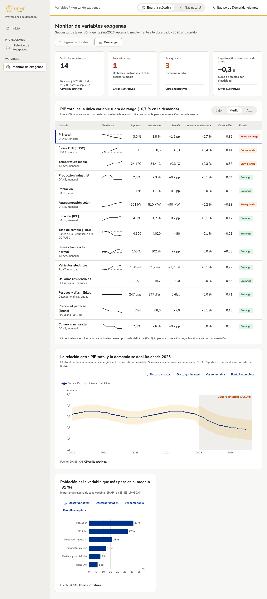

# Monitor de variables exógenas

!!! warning "Cifras ilustrativas"
    Mientras se cargan los supuestos y los datos observados, las cifras son de ejemplo y lo dicen en cada indicador y gráfico. Los umbrales de estado también son de ejemplo hasta definirlos (pendiente X-03).

## Para qué sirve
Compara los **supuestos de la revisión vigente** (PIB, clima, población, precios…) con **lo observado en el año corrido**, y estima cuánto afecta cada diferencia a la demanda. Sirve para detectar a tiempo una variable que se aleja de lo supuesto y decidir si hay que revisar la proyección.

## Cómo llegar
Menú lateral: **Variables › Monitor de exógenas**, o `/app/variables/exogenas`. También desde las alertas del tablero ejecutivo («Ver variable», «Ver monitor»), que abren el monitor con la variable de la alerta elegida.

## Qué muestra
- **Cuatro indicadores:** variables monitoreadas, cuántas están fuera de rango, cuántas en vigilancia y el impacto estimado en la demanda del año (la suma del efecto de cada variable).
- **Tabla de variables:** nombre, fuente y frecuencia; tendencia reciente (línea sólida: observado; punteada: supuesto); supuesto, observado y desvío; impacto en la demanda; correlación con la demanda y estado (**Fuera de rango**, **En vigilancia** o **En rango**). El título resume el hallazgo principal. Las unidades largas (COP/USD, USD/bbl, millones) aparecen junto a la fuente, no en cada celda.
- **Relación con la demanda:** la correlación móvil de 24 meses de la variable elegida con la demanda, con su intervalo de confianza del 95 % como banda. Si se detecta un quiebre (método CUSUM), el tramo aparece sombreado y el título dice si la relación se debilita o se fortalece.
- **Qué pesa más en el modelo:** la importancia relativa (SHAP) de cada variable en el modelo de la revisión vigente.

## Cómo se usa (paso a paso)
1. Elija el producto en el encabezado (**Energía eléctrica** o **Gas natural**).
2. Elija el escenario de los supuestos (**Bajo**, **Medio** o **Alto**) sobre la tabla. Los estados, los desvíos, el impacto y los indicadores cambian con el escenario.
3. Toque una fila para ver la relación de esa variable con la demanda en el gráfico de abajo. Por defecto se muestra la variable fuera de rango de mayor impacto.
4. Toque el título de una columna (Variable, Impacto, Correlación o Estado) para ordenar la tabla.
5. Descargue la tabla con **Descargar**, o los datos e imagen de cada gráfico con sus acciones.

## Filtros y opciones
| Opción | Qué hace |
| --- | --- |
| Energía eléctrica / Gas natural | Producto (`?producto=gn`). |
| Bajo / Medio / Alto | Escenario de los supuestos (`?escenario=low`). |
| Fila de la tabla | Variable del gráfico de correlación (`?variable=gdp`). |
| Descargar | CSV de la tabla del producto y escenario elegidos. |
| Configurar umbrales | **En construcción**: los umbrales están por definir (X-03). |

## Preguntas frecuentes
**¿Cuándo una variable está «Fuera de rango» o «En vigilancia»?** Cuando su desvío frente al supuesto supera el umbral de esa variable. Hoy los umbrales son de ejemplo; los oficiales están por definir (X-03).

**¿Cómo se calcula el impacto en la demanda?** Es el desvío de la variable multiplicado por su elasticidad en el modelo de la revisión vigente. El impacto total es la suma de todas las variables. Llega calculado con cada revisión; la plataforma no lo recalcula.

**¿Qué diferencia hay entre la columna Correlación y el gráfico?** La columna es la correlación en el periodo con el que se estimó el modelo. El gráfico muestra cómo ha cambiado en ventanas móviles de 24 meses, para ver si la relación se mantiene.

**¿Por qué la tendencia no tiene ejes?** Solo muestra la forma: si lo observado sube, baja o se aleja del supuesto. Las cifras exactas están en las columnas de al lado.

## Historial
- 2026-11-09: primera versión con cifras ilustrativas (diario técnico: `2026-11-09-monitor-exogenas`).
