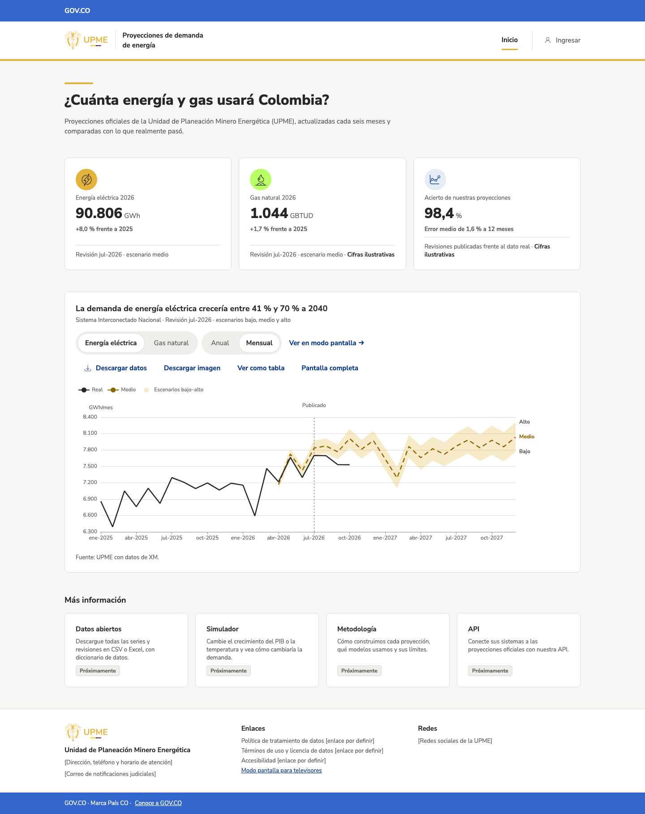
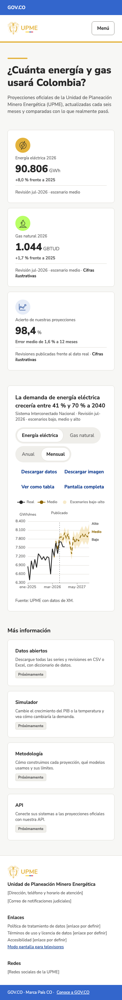

# Inicio del portal

!!! warning "Datos reales provisionales y cifras ilustrativas"
    **Energía eléctrica ya muestra datos reales** (desde T-37): las revisiones publicadas por la UPME (serie SIN+GCE+ME+GD_UPME) y la demanda del SIN de XM. Es una conexión **provisional**: los escenarios «bajo» y «alto» son los límites del intervalo de confianza del 68 % de la revisión, porque la UPME publica para energía eléctrica un escenario medio con intervalos y no escenarios bajo y alto. Los indicadores de error son provisionales y el umbral es ilustrativo (X-03, X-25).

    Gas natural y el acierto de las proyecciones siguen con cifras de ejemplo, y lo dicen junto a cada número y gráfico.

## Para qué sirve
Responde, sin necesidad de registrarse, **cuánta energía eléctrica y gas natural usará Colombia** según la proyección oficial vigente de la UPME, y qué tan acertadas han sido las proyecciones anteriores. Está pensada para la ciudadanía, empresas del sector, academia y otras entidades.

## Cómo llegar
Es la página principal del sitio: `/`. También se llega desde cualquier página con el logo de la UPME o con «Inicio» en el menú.

## Qué muestra
- **Pregunta principal** y una explicación corta de qué son las proyecciones.
- **Tres cifras clave:**
    - demanda proyectada de energía eléctrica para el próximo año, en GWh, y cuánto cambia frente al último año con dato real;
    - lo mismo para gas natural, en GBTUD;
    - el acierto de las proyecciones publicadas y su error medio.
- **Gráfico de la proyección vigente:** el dato real (línea sólida) y la proyección hasta 2040 en el escenario medio (línea discontinua), con la banda entre los escenarios bajo y alto. El título dice cuánto crecería la demanda.
- **Próximamente:** datos abiertos, simulador, metodología y API. Aún no están disponibles.
- **Ingresar:** a la derecha del menú superior, para el equipo de la UPME que usa la app interna ([Inicio de la app interna](app-inicio.md)).
- **Acceso al modo pantalla** para televisores: «Ver en modo pantalla →» junto al gráfico (en computador) y en el pie de página.
- **Pie de página** con los datos de la entidad y los enlaces legales.

## Cómo se usa (paso a paso)
1. Lea las tres cifras clave: cada una dice de qué revisión sale.
2. En el gráfico, elija **Energía eléctrica** o **Gas natural**.
3. Pase el cursor (o toque) sobre el gráfico para ver el valor de cada año y la diferencia entre lo real y lo proyectado.
4. Use **Ver como tabla** para leer los mismos datos en una tabla, o **Descargar datos** para obtenerlos en CSV.

## Filtros y opciones
| Opción | Qué hace |
| --- | --- |
| Energía eléctrica / Gas natural | Cambia el producto del gráfico. Queda en la dirección de la página (`?producto=gn`), así que se puede compartir. |
| Anual / Mensual | Muestra el gráfico por mes (GWh/mes, por omisión) o por año (TWh/año). En mensual se ve la estacionalidad y el detalle real frente a proyectado mes a mes, y el gráfico abre alrededor de la revisión: desde un año antes de su publicación hasta un año después del último dato real (para la revisión jul-2026 con datos a oct-2026, de 2025 a 2027). Una línea vertical marca el mes de publicación («Publicado») y otra el corte del dato real. Solo energía eléctrica: gas natural siempre se ve anual. Queda en la dirección (`?resolucion=anual`). El título sigue con el crecimiento anual. En anual se ve toda la serie. |
| Descargar datos | Descarga un CSV con el dato real y los tres escenarios, con fuente, versión, fecha de corte y licencia. |
| Descargar imagen | Descarga el gráfico como imagen PNG. |
| Ver como tabla | Muestra los datos del gráfico en una tabla. |
| Pantalla completa | Amplía el gráfico; el mismo botón dice **Salir de pantalla completa** para volver (también con la tecla Esc). |
| Ingresar | Lleva a la app interna; si no hay sesión, pide ingresar primero. |
| Ver en modo pantalla → | Abre los tableros para televisores ([Modo pantalla](modo-pantalla.md)). Solo en pantallas de computador. |

En el teléfono, el menú se abre con el botón **Menú**.

{ width="320" }

## Preguntas frecuentes
**¿Qué es un escenario?** Una proyección con supuestos distintos sobre la economía, la población y el clima. El medio es el más probable; el bajo y el alto marcan el rango razonable.

**¿Cada cuánto se actualiza?** Las proyecciones se publican cada seis meses y el dato real se actualiza cuando lo publican XM y el Gestor del Mercado de Gas.

**¿Por qué algunas cifras dicen «Cifras ilustrativas»?** Porque todavía son datos de ejemplo: gas natural y el acierto de las proyecciones. Las de energía eléctrica ya son reales. El aviso desaparecerá cuando se conecten las demás.

## Historial
- 2026-11-08: primera versión con cifras ilustrativas (diario técnico: `2026-11-08-portal-inicio`).
- 2026-11-08: acceso al modo pantalla (diario técnico: `2026-11-08-modo-pantalla`).
- 2026-11-08: enlace «Ingresar» a la app interna (diario técnico: `2026-11-08-app-interna`).
- 2026-11-10: energía eléctrica con datos reales, de forma provisional, y gráfica anual o mensual (T-37, issue #40; diario técnico: `2026-11-10-datos-reales-ee`).
