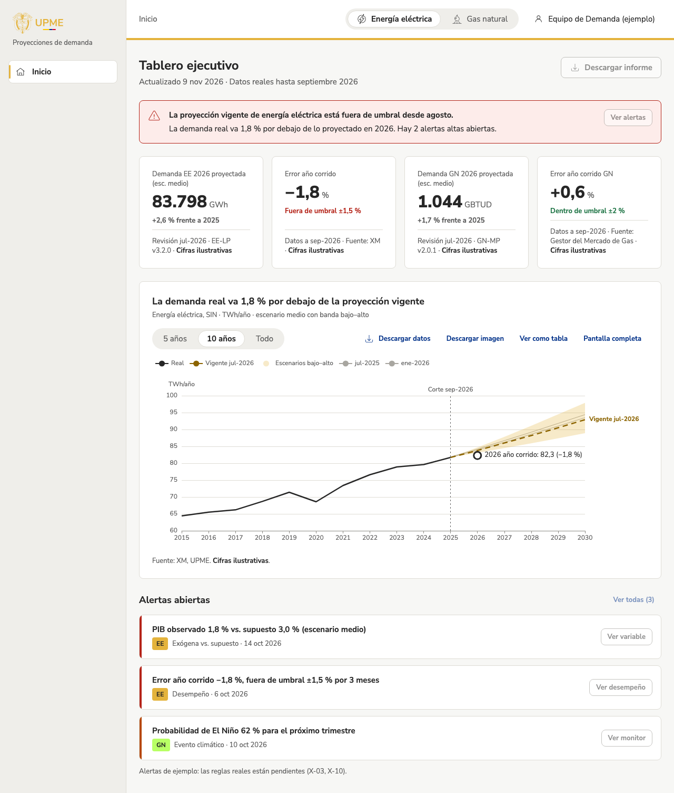

# Tablero ejecutivo

!!! warning "Cifras ilustrativas"
    Mientras se cargan los datos oficiales, las cifras, el gráfico y las alertas son de ejemplo y lo dicen junto a cada uno.

## Para qué sirve
Responde en un minuto si **la proyección vigente sigue siendo válida** para energía eléctrica y gas natural, y qué hay que revisar primero. Es la página de inicio de la app interna, pensada para la Subdirectora, el Director y el equipo de la Subdirección de Demanda.

## Cómo llegar
- Desde el portal público: **Ingresar**.
- En la app: **Inicio**, en el menú lateral, o `/app`.

## Qué muestra
- **Aviso rojo** (solo si hace falta): cuándo la proyección vigente de un producto se salió del umbral aceptado, cuánto va la demanda real por encima o por debajo y cuántas alertas altas hay.
- **Cuatro cifras:** la demanda proyectada del año para energía eléctrica y gas natural, y el **error del año corrido** de cada uno (en rojo si está fuera del umbral, en verde si está dentro). Cada cifra dice de qué revisión, modelo y fuente sale.
- **Gráfico** del producto elegido en el encabezado: el dato real (línea sólida), la proyección vigente (discontinua) con la banda entre los escenarios bajo y alto, las dos revisiones anteriores (líneas finas), la fecha de corte de los datos y un punto con lo que va del año corrido. El título dice el hallazgo.
- **Alertas abiertas:** cada una con su severidad (barra de color), lo que pasó con la cifra, el producto, el tipo y la fecha.

## Cómo se usa (paso a paso)
1. Mire el aviso rojo y las cuatro cifras: dicen si algo está fuera de lo esperado.
2. Elija **Energía eléctrica** o **Gas natural** en el encabezado para ver el gráfico de ese producto.
3. Cambie el rango del gráfico entre **5 años**, **10 años** y **Todo**.
4. Pase el cursor sobre el gráfico para ver el valor de cada año y la diferencia entre lo real y lo proyectado.
5. Revise las alertas abiertas, de la más grave a la menos grave.

## Filtros y opciones
| Opción | Qué hace |
| --- | --- |
| Energía eléctrica / Gas natural (encabezado) | Producto del gráfico; se mantiene en toda la app. |
| 5 años / 10 años / Todo | Años que muestra el gráfico; queda en la dirección (`?rango=5`). |
| Descargar datos, Descargar imagen, Ver como tabla, Pantalla completa | Acciones del gráfico. |
| Descargar informe | **En construcción** (X-19). |
| Ver alertas, Ver todas y las acciones de cada alerta | **En construcción**: llevarán a las vistas de alertas, del monitor de variables y de desempeño cuando existan. |

## Preguntas frecuentes
**¿Qué es el «error del año corrido»?** Cuánto se ha alejado la demanda real de lo proyectado en lo que va del año, en porcentaje. Negativo: la demanda real va por debajo.

**¿Qué es el umbral?** El margen de error que se acepta antes de considerar que la proyección necesita revisión. Los valores definitivos están por definir; hoy son de ejemplo.

**¿Por qué los botones de las alertas no hacen nada?** Llevan a vistas que todavía se están construyendo. Al dejar el cursor encima dicen «en construcción».

## Historial
- 2026-11-09: primera versión con cifras ilustrativas (diario técnico: `2026-11-09-tablero-ejecutivo`).
